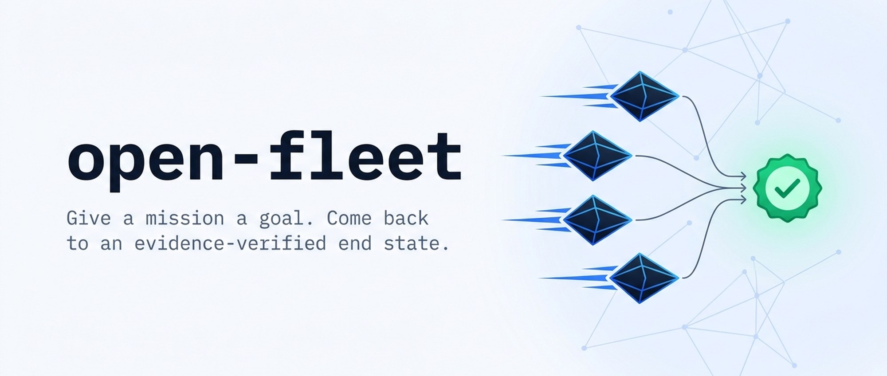
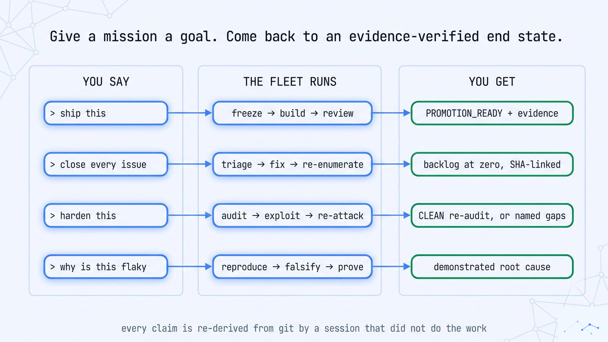
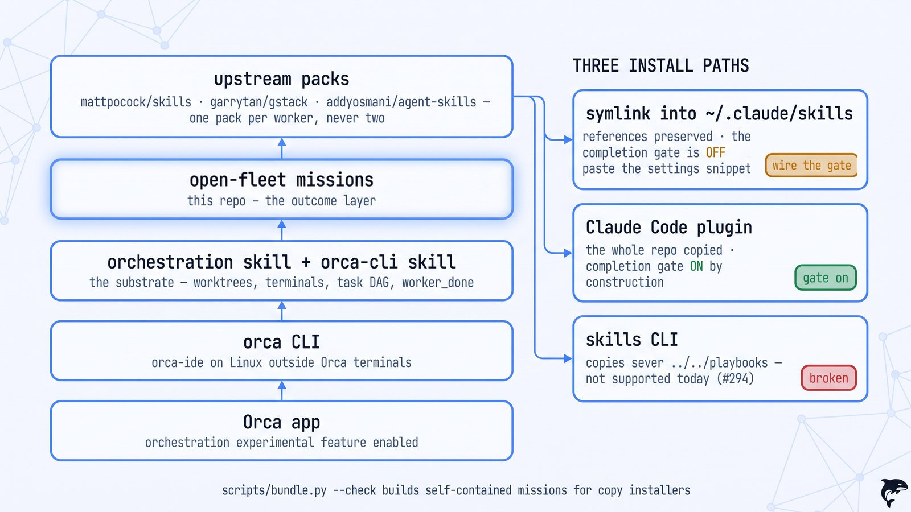
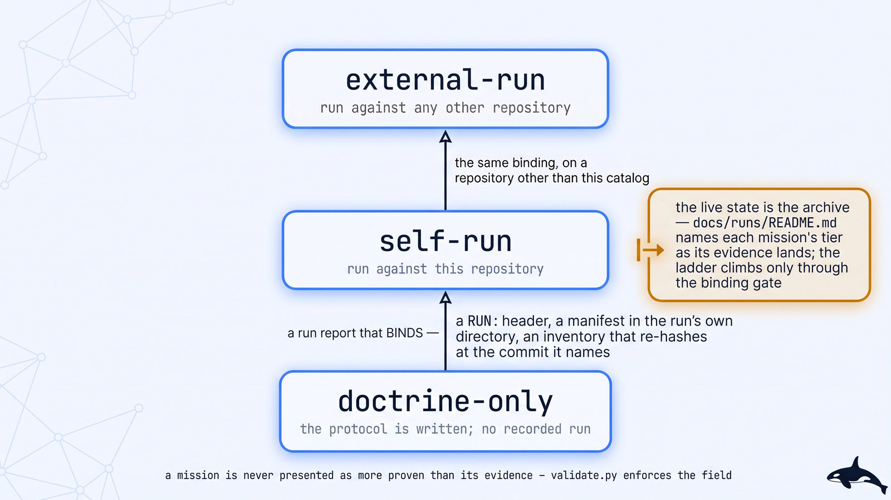
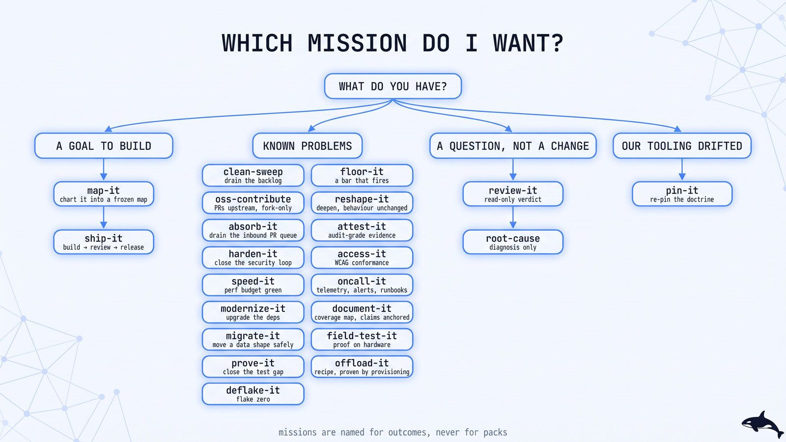
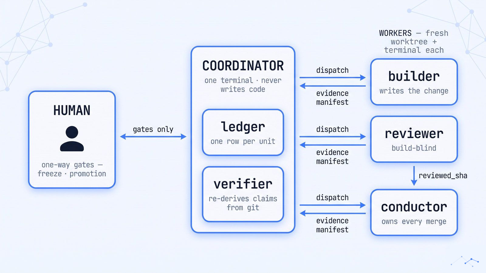
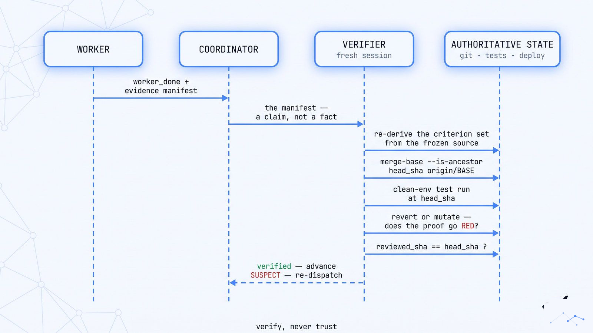
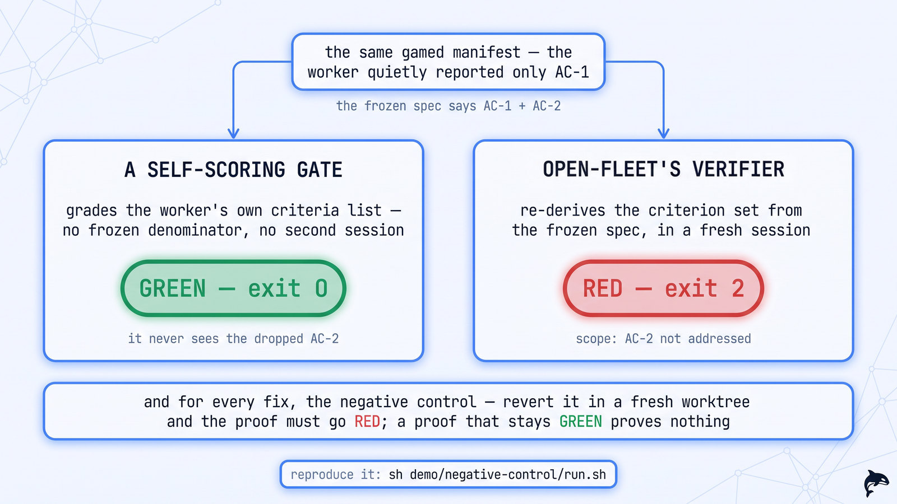
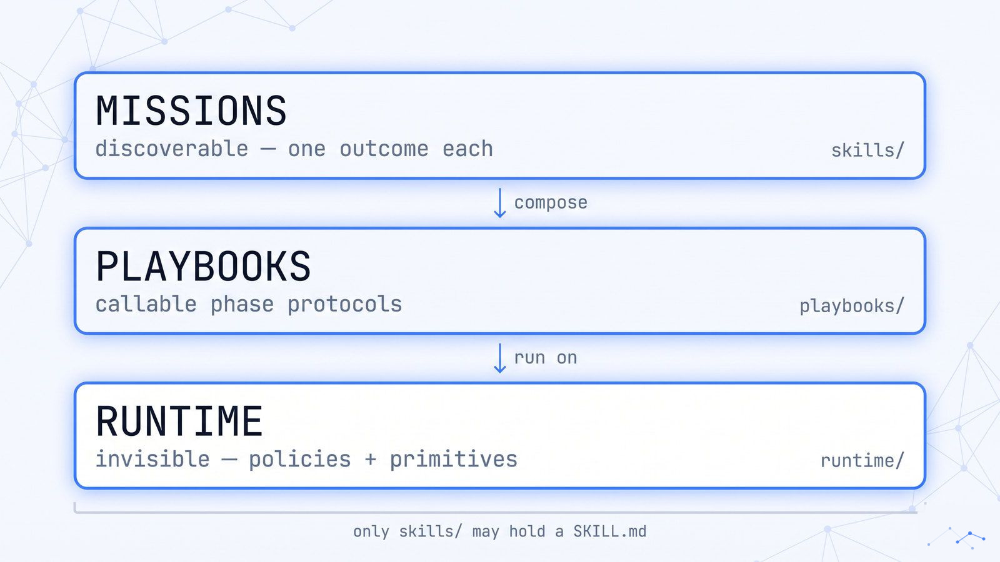

<p align="center">
  <picture>
    <source media="(prefers-color-scheme: dark)" srcset="assets/hero-dark.jpg">
    <source media="(prefers-color-scheme: light)" srcset="assets/hero-light.jpg">
    
  </picture>
</p>

<p align="center">
  <a href="LICENSE"></a>
  <a href="https://agentskills.io/specification"></a>
  <a href="skills/"></a>
  <a href="tests/"></a>
  <a href="CHANGELOG.md"></a>
</p>

<p align="center">
  <b>Autonomous engineering fleets for coding agents: give a bounded goal, get a SHA-verified outcome with evidence.</b><br/>
  <a href="docs/README.md">Documentation Hub</a> ·
  <a href="docs/getting-started.md">Quickstart</a> ·
  <a href="docs/install.md">Install</a> ·
  <a href="docs/adoption-guide.md">Adoption Guide</a> ·
  <a href="docs/missions/README.md">Mission Catalog</a> ·
  <a href="docs/recipes.md">Prompt Recipes</a> ·
  <a href="docs/runtimes.md">Runtimes &amp; Harnesses</a> ·
  <a href="docs/comparison.md">Ecosystem Comparison</a> ·
  <a href="docs/concepts.md">Concepts</a> ·
  <a href="ARCHITECTURE.md">Architecture</a> ·
  <a href="docs/troubleshooting.md">Troubleshooting</a> ·
  <a href="CONTRIBUTING.md">Contributing</a> ·
  <a href="SECURITY.md">Security</a> ·
  <a href="docs/ops.md">Ops</a>
</p>

---

**open-fleet** is an open-source catalog of outcome-driven autonomous fleets for the [Orca](https://github.com/stablyai/orca) runtime and the [open-fleet Runtime Provider Interface (RPI)](docs/runtimes.md) (including standalone `posix` sessions without the Orca desktop app). It is an independent, community-maintained project, not affiliated with or endorsed by Stably ([third-party notices](THIRD_PARTY_NOTICES.md)).

Each **mission** is a complete engineering workflow: a coordinator decomposes your goal into units, dispatches isolated workers (each loading a single methodology pack from [mattpocock/skills](https://github.com/mattpocock/skills), [garrytan/gstack](https://github.com/garrytan/gstack), or [addyosmani/agent-skills](https://github.com/addyosmani/agent-skills)), and grades completion through an **independent, SHA-bound verifier** outside the worker session that produced the code.

| Your goal | Start here |
|---|---|
| **Run your first mission in 5 minutes** | [Install](docs/install.md) → [Your first `review-it` dry run](docs/getting-started.md#your-first-mission-a-review-it-dry-run) |
| **Roll out fleets on a greenfield or legacy codebase** | [Greenfield vs. Brownfield adoption guide](docs/adoption-guide.md) |
| **Pick the right workflow for a task** | [Mission catalog by category](#the-mission-catalog) · [Prompt recipes](docs/recipes.md) |
| **Compare with `gstack`, `agent-skills`, `mattpocock`, & `superpowers`** | [Ecosystem comparison & pack composition](docs/comparison.md) |
| **Run on Orca, standalone POSIX, or 12 other orchestrators** | [Multi-runtime & harness guide](docs/runtimes.md) (`OPEN_FLEET_RUNTIME=orca\|posix\|overstory\|...`) |
| **Understand what a run proves (and doesn't)** | [The evidence protocol](#the-evidence-protocol) · [Proof status](#proof-status) · [Concepts](docs/concepts.md) |
| **Contribute or run local contract tests** | [Local development](docs/development.md) — requires only `git` and Python ≥ 3.11 |

<p align="center">
  <picture>
    <source media="(prefers-color-scheme: dark)" srcset="assets/diagrams/you-say.jpg">
    <source media="(prefers-color-scheme: light)" srcset="assets/diagrams/you-say-light.jpg">
    
  </picture>
</p>

<details>
<summary>Text version</summary>

```
 YOU SAY                          THE FLEET RUNS                        YOU GET
┌──────────────────────┐      ┌─────────────────────────────┐      ┌──────────────────────────────┐
│ "ship this"          │ ───▶ │ freeze → build → review     │ ───▶ │ PROMOTION_READY + evidence   │
│ "close every issue"  │ ───▶ │ triage → fix → re-enumerate │ ───▶ │ backlog at zero, SHA-linked  │
│ "harden this"        │ ───▶ │ audit → exploit → re-attack │ ───▶ │ CLEAN re-audit, or named gaps│
│ "why is this flaky"  │ ───▶ │ reproduce → falsify → prove │ ───▶ │ demonstrated root cause      │
└──────────────────────┘      └─────────────────────────────┘      └──────────────────────────────┘
```

</details>

## Quick start

**One-command install** (validates the catalog, links missions into `~/.claude/skills`, and prints completion-gate setup; verified in CI from a clean container — [transcript](docs/completion/evidence/414-clean-container-install.txt)):

```bash
git clone https://github.com/ravidsrk/open-fleet.git && cd open-fleet && sh scripts/install.sh
```

**Selective symlink install** (link only the missions you want to try first):

```bash
# 1. Clone the catalog and keep the checkout on disk
git clone https://github.com/ravidsrk/open-fleet.git
cd open-fleet

# 2. Symlink selected missions into Claude Code (link, do not copy — missions resolve
#    playbooks/ and runtime/ relative to the repository root)
mkdir -p ~/.claude/skills
ln -s "$(pwd)/skills/review-it" ~/.claude/skills/review-it
ln -s "$(pwd)/skills/ship-it" ~/.claude/skills/ship-it

# 3. Wire the completion gate into ~/.claude/settings.json
sh hooks/print-settings-snippet.sh
```

> [!IMPORTANT]
> **Wire the completion gate on symlink installs.** `hooks/hooks.json` binds the verifier through `${CLAUDE_PLUGIN_ROOT}`, which Claude Code populates only for plugin installs. A `ln -s` into `~/.claude/skills/` loads no plugin, so without the `print-settings-snippet.sh` configuration above, missions run with no completion gate at all. **Pick one install path per host — do not stack the symlink install with the Claude Code plugin** ([Install paths](docs/install.md#pick-one-install-path-per-host-do-not-stack)).

<details>
<summary><b>Paste-into-agent install prompt</b> (let your coding agent install and verify the catalog)</summary>

Paste this into Claude Code, Codex, Gemini CLI, or OpenCode:

```text
Clone https://github.com/ravidsrk/open-fleet.git into ~/open-fleet (full clone, no --depth 1),
run `sh scripts/install.sh && sh scripts/install.sh --check`, print the completion-gate snippet
with `sh hooks/print-settings-snippet.sh`, and run the fail-closed check
`ORCA_MANIFEST=/nonexistent.json sh runtime/scripts/verify-gate.sh --event stop` (expect exit 2).
```

</details>

<details>
<summary><b>See a mission run (60-second terminal transcript)</b></summary>

```text
You:
  ship this: add GET /healthz through the existing router. Return version and DB connectivity,
  with 503 when the database is unavailable. Stop at the promotion PR.

Coordinator (ship-it):
  [PHASE 0 · PREFLIGHT]
  $ python3 runtime/scripts/preflight.py --mission ship-it --base ship-it/integration
  PREFLIGHT=OK runtime=posix base=ship-it/integration baseline_tests=PASS (42 passed in 1.8s)

  [PHASE 1 · FREEZE SPEC — One-Way Human Gate]
  DECISION (freeze grill) · specs/healthz.md · DB timeout threshold
    (a) 500ms statement timeout on ping query — fast fail for load balancers  [recommended]
    (b) 5000ms pool connection timeout — matches default query pool
  Reply 'a' or 'b'. No timeout default — the freeze is a one-way gate.

You:
  a

Coordinator (ship-it):
  Spec frozen at specs/healthz.md@0b073fb (digest sha256:8f1c… · criteria: AC-1, AC-2).
  [PHASE 2 · BUILD] Dispatched U1 (builder · PROFILE=rw · pack=mattpocock · worktree=fleet/u1-healthz)
  [PHASE 3 · REVIEW] Dispatched R1 (build-blind reviewer · PROFILE=ro · pack=gstack)
    → PR #14 APPROVED at reviewed_sha=9b06458 (matches head_sha=9b06458)
  [PHASE 3 · VERIFY]
  $ python3 runtime/scripts/verify.py --manifest docs/reports/u1-manifest.json --base ship-it/integration \
      --contract-source specs/healthz.md@0b073fb --contract-digest sha256:8f1c… \
      --execute-nc --nc-command "pnpm test src/health"
  VERIFY=PASS unit=U1 scope=2/2 ancestor=OK review=FRESH negative_control=RED_ON_REVERT (exit 1)
  [PHASE 4 · CONDUCTOR] Merged PR #14 → ship-it/integration (merge_sha=c41d902).
  Opened promotion PR #15 (ship-it/integration → main). Terminal state: PROMOTION_READY.
```

</details>

## Before you run a mission

Understand the operational boundary before dispatching workers on a repository:

- **Unattended worker permissions:** Workers run your coding agent with interactive prompts disabled (`--dangerously-skip-permissions` or harness equivalent) so unattended runs do not hang. A git worktree is checkout isolation, not an OS security sandbox.
- **Integration branch isolation:** Workers open pull requests against a fleet-managed integration `BASE` branch, never your default branch (`main`). Promoting `BASE` to your default branch is always a human gate.
- **Off-worker verification is authoritative:** Inside a worker's own session, the completion gate is advisory, and in the global settings snippet `deny-hook.sh` is unregistered by construction (worktree dispatch wires `deny-hook.sh` per-worktree where supported). Authoritative verification happens off-worker (via the coordinator, CI, or subprocess).
- **Start safely:** For your first run, use a disposable repository, a VM, or an [`offload-it`](docs/missions/offload-it.md) sandbox recipe. See [Verify gate & trust boundary](docs/verify-gate.md#trust-boundary) and [`runtime/sandbox-policy.md`](runtime/sandbox-policy.md).

## Requirements

<p align="center">
  <picture>
    <source media="(prefers-color-scheme: dark)" srcset="assets/diagrams/install-stack.jpg">
    <source media="(prefers-color-scheme: light)" srcset="assets/diagrams/install-stack-light.jpg">
    
  </picture>
</p>

To run missions on a target repository, you need ([pinned prerequisites](docs/distribution.md#prerequisites-pinned)):

1. **An orchestration runtime** ([Multi-runtime & harness guide](docs/runtimes.md)):
   - **Default (`orca`):** The [Orca app](https://github.com/stablyai/orca) at or above the catalog pin **v1.4.238** (`runtime/pins.json`) with orchestration enabled, the `orca` CLI (`orca-ide` on Linux), and Orca's `orchestration` and `orca-cli` skills installed.
   - **Standalone (`posix`) or external orchestrators:** Set `OPEN_FLEET_RUNTIME=posix` to dispatch via local git worktrees and background processes (`tmux`, `cmux`, or `setsid`) with no Orca app required, or select one of the other supported RPI providers.
2. **A coding-agent harness:** Claude Code (`claude`), Codex (`codex`), Gemini CLI (`gemini`), OpenCode (`opencode`), Oh My Pi (`omp`), Pi (`pi`), `jcode`, Goose (`goose`), Hermes Agent (`hermes`), or Crush (`crush`), plus the OpenHands SDK agent (`openhands` on `OPEN_FLEET_RUNTIME=openhands`; `opencode`, `omp`, and `pi` require a non-`orca` runtime such as `posix` or a `WORKER_CMD` override — see [certification matrix](docs/certification.md)).
3. **`git` and `gh`** (authenticated for GitHub PR and review verification, or `orca linear` / `orca jira` for hosted trackers).
4. **Python 3.11+** (standard library only) for catalog validation and runtime verification scripts.
5. **Upstream methodology packs** referenced by the missions you run ([mattpocock/skills](https://github.com/mattpocock/skills), [garrytan/gstack](https://github.com/garrytan/gstack), [addyosmani/agent-skills](https://github.com/addyosmani/agent-skills)) — mounted one pack per worker ([why](docs/concepts.md#one-router-per-worker)). Per-mission CLI tools are listed in [Getting started](docs/getting-started.md#prerequisites).

## The mission catalog

Every mission represents a distinct engineering outcome with its own unit of work, state machine, convergence proof, and SHA-bound evidence contract. Missions are grouped below by **developer job-to-be-done**:

### 1. Plan, Build & Ship

| Mission | Proof | Outcome (definition of done) | Use when |
|---|---|---|---|
| 🗺️ **[map-it](docs/missions/map-it.md)** | `doctrine-only` | A foggy multi-session goal resolved into a frozen execution map `ship-it` can consume — decisions, not deliverables | "chart this", "plan this epic", "I don't know the shape yet" |
| 🚢 **[ship-it](docs/missions/ship-it.md)** | `external-run` | Intent or a frozen spec → a released, verified change, stopped at the highest release state you authorized (`BUILT` → `PROMOTION_READY` → `RELEASED` → `DEPLOYED_AND_VERIFIED`) | "build and ship this", spec-to-shipped-product |
| 🤝 **[oss-contribute](docs/missions/oss-contribute.md)** | `doctrine-only` | Upstream issues on a repo you do NOT control, each landed as an open, reviewed, etiquette-correct PR: `CONTRIBUTED` or `CONTRIBUTED-WITH-PARKED` | "contribute to this project", "open PRs upstream", "we only have a fork" |
| 📥 **[absorb-it](docs/missions/absorb-it.md)** | `doctrine-only` | An inbound PR queue drained: each contribution absorbed with authorship preserved and a RED-on-base / GREEN-on-head receipt, refuted, or parked: `ABSORBED` or `ABSORBED-WITH-PARKED` | "drain the PR queue", "absorb these community contributions" |

### 2. Fix, Sweep & Stabilize

| Mission | Proof | Outcome (definition of done) | Use when |
|---|---|---|---|
| 🧹 **[clean-sweep](docs/missions/clean-sweep.md)** | `self-run` | A finite backlog exhausted to zero, PR-per-finding, every close backed by a merged SHA + a test that failed pre-fix; re-enumerated until dry | "close every issue", "fix everything in this audit", "the README lies" |
| 🎯 **[deflake-it](docs/missions/deflake-it.md)** | `doctrine-only` | Flake eradication to a statistical streak, local **and** CI: `STABLE` or `STABLE-WITH-QUARANTINE` | "kill the flaky tests", "deflake the suite" |
| 📱 **[field-test-it](docs/missions/field-test-it.md)** | `doctrine-only` | On-device reproduce → fix → re-verify at the head SHA with a revert negative control: `FIELD-PROVEN` or `FIELD-PROVEN-WITH-PARKED` | "test on a real device", "works on desktop, breaks on mobile", "emulator QA" |

### 3. Review, Diagnose & Prove

| Mission | Proof | Outcome (definition of done) | Use when |
|---|---|---|---|
| 🔍 **[review-it](docs/missions/review-it.md)** | `external-run` | A trusted, read-only, SHA-bound GO/NO-GO verdict — acceptance always, risk lenses when the diff triggers them. **No fix authority.** | "review this PR", "is this ready to merge" |
| 🔬 **[root-cause](docs/missions/root-cause.md)** | `doctrine-only` | A reproduced symptom and a demonstrated cause: repro-first → falsify rival hypotheses → one survivor, with evidence; optional fix handoff | "diagnose this", "why is this happening" |
| 🧪 **[prove-it](docs/missions/prove-it.md)** | `self-run` | A mutation-audited critical surface: `COVERED` or `COVERED-WITH-PARKED`, tests that die when the code is mutated | "close the test gap", "cover the critical paths" |
| 🧱 **[floor-it](docs/missions/floor-it.md)** | `doctrine-only` | A written, numbered quality bar: one tool per frozen dimension, every gate proven RED on an injected violation before it blocks CI: `FLOORED` or `FLOORED-WITH-PARKED` | "set the quality bar", "make CI enforce", "define our standards" |

### 4. Audit, Harden & Attest

| Mission | Proof | Outcome (definition of done) | Use when |
|---|---|---|---|
| 🛡️ **[harden-it](docs/missions/harden-it.md)** | `self-run` | A threat model closed: audit → exploit → fix → **re-attack the fix** → clean re-audit finds zero unrefuted P0/P1 (or `HARDENED-WITH-OPEN-ITEMS`) | "harden this", "security sweep", "red team" |
| 📋 **[attest-it](docs/missions/attest-it.md)** | `doctrine-only` | Conformance to a frozen standard (EU AI Act Art-12/50, SOC 2, NIST SSDF) proven with independently re-derived evidence: `CONFORMANT` or `CONFORMANT-WITH-GAPS` | "prove compliance", "conformance", "SOC 2 / EU AI Act / SSDF" |
| ♿ **[access-it](docs/missions/access-it.md)** | `doctrine-only` | A frozen page/flow set driven to WCAG 2.2 AA (EAA/ADA/508) with a deterministic axe-core oracle + revert negative control: `CONFORMANT` or `CONFORMANT-WITH-MANUAL-PARKED` | "accessibility", "a11y", "WCAG", "screen reader / keyboard" |
| ⚡ **[speed-it](docs/missions/speed-it.md)** | `doctrine-only` | A perf budget met against a pre-declared measurement contract: `WITHIN-BUDGET` or `OPTIMIZED-WITH-PARKED` | "the app is slow", "perf budget", "Core Web Vitals" |

### 5. Evolve, Refactor & Migrate

| Mission | Proof | Outcome (definition of done) | Use when |
|---|---|---|---|
| 📦 **[modernize-it](docs/missions/modernize-it.md)** | `doctrine-only` | Dependency currency via expand/migrate/contract at the code level: `CURRENT` or `CURRENT-WITH-PINNED`, every pin justified | "update the dependencies", "framework migration" |
| 🧬 **[reshape-it](docs/missions/reshape-it.md)** | `doctrine-only` | Confirmed hot modules deepened behind smaller, testable interfaces with behaviour demonstrably unchanged: `RESHAPED` or `RESHAPED-WITH-PARKED` | "god file", "architecture erosion", "refactor the hot path safely" |
| 🗄️ **[migrate-it](docs/missions/migrate-it.md)** | `doctrine-only` | A stateful shape change landed across deploys — expand → dual-write → backfill → switch reads → zero readers → contract: `MIGRATED`, `MIGRATED-WITH-PARKED`, or `ABANDONED` | "migrate the database", "rename this column safely", "backfill without downtime" |

### 6. Operate, Document & Provision

| Mission | Proof | Outcome (definition of done) | Use when |
|---|---|---|---|
| 📟 **[oncall-it](docs/missions/oncall-it.md)** | `doctrine-only` | A frozen path set made operable: every on-call question answered by a quoted signal, alerts test-fired, and an induced staging failure named by a source-blind worker: `OPERABLE` or `OPERABLE-WITH-PARKED` | "make this operable", "we were blind during the incident", "add observability" |
| 📚 **[document-it](docs/missions/document-it.md)** | `doctrine-only` | A public surface covered by quadrant with zero critical gaps, every claim bound to a `file:symbol` or a run and proven by a rename-to-RED control: `DOCUMENTED` or `DOCUMENTED-WITH-PARKED` | "document this project", "the API is undocumented", "docs coverage" |
| ☁️ **[offload-it](docs/missions/offload-it.md)** | `doctrine-only` | *Environment setup:* A per-workspace environment recipe stood up end to end — doctor-clear plus a live create→validate→destroy lifecycle: `OFFLOADED` or `OFFLOADED-WITH-PARKED` | "run this in the cloud", "sandbox recipe", "per-workspace environment" |
| 📌 **[pin-it](docs/missions/pin-it.md)** | `doctrine-only` | *Maintainer-facing:* Runtime doctrine re-witnessed against the installed binary — every mechanics claim receipted CURRENT, patched, or removed: `PINNED` or `PINNED-WITH-PARKED` | "Orca updated", "re-pin the runtime contract", "policy lags practice" |

## Proof status

<p align="center">
  <picture>
    <source media="(prefers-color-scheme: dark)" srcset="assets/diagrams/proof-ladder.jpg">
    <source media="(prefers-color-scheme: light)" srcset="assets/diagrams/proof-ladder-light.jpg">
    
  </picture>
</p>

Every mission's `metadata:` block carries a validator-enforced `proof:` tier (`doctrine-only`, `self-run`, or `external-run`). Advancing past `doctrine-only` requires retained artifacts that hash true at a named commit: a run report with a `RUN:` header, a per-unit evidence manifest in the run's `docs/runs/` directory, and a SHA-256 inventory verified at the commit the header names.
<!-- BEGIN GENERATED: proof-status — scripts/gen-badges.py -->
**Today `review-it` and `ship-it` read `external-run`; `clean-sweep`, `harden-it` and `prove-it` read `self-run`; every other mission reads `doctrine-only`.**
<!-- END GENERATED: proof-status -->
Browse all retained runs in the [run archive](docs/runs/README.md). Note the scope of the static repository gate: it hashes, it does not re-run the verifier against a live target checkout; see [Concepts — Proof status](docs/concepts.md#proof-status) for how static binding and live verification complement each other.

### Highlighted verified runs

| Mission | Proof tier | Target & verified outcome | Retained report & artifacts |
|---|---|---|---|
| 🚢 **[ship-it](docs/missions/ship-it.md)** | `external-run` | Built `ravidsrk/mdtoc` from a frozen spec to `BUILT @ 046d1f8d` across 6 vertical slices (110 tests), catching and repairing an integration seam failure before re-review PASS | [2026-10-13-ship-it-mdtoc.md](docs/runs/2026-10-13-ship-it-mdtoc.md) |
| 🔍 **[review-it](docs/missions/review-it.md)** | `external-run` | Reviewed `stablyai/orca#28206` via 4 parallel `PROFILE=ro` workers to a SHA-bound `NO-GO` verdict (0 Critical, 2 Required: caught a submodule Force Delete data-loss bug); plus 4 live `posix` witness runs on macOS & Ubuntu | [2026-10-13-review-it-linux.md](docs/runs/2026-10-13-review-it-linux.md) · [2026-10-24-review-it-first-run.md](docs/runs/2026-10-24-review-it-first-run.md) |
| 🧹 **[clean-sweep](docs/missions/clean-sweep.md)** | `self-run` | Drained tracker backlog across 10 units in 2 waves to `DRY-WITH-PARKED`, each fix backed by a pre-fix `RED` test and SHA-256 inventory | [2026-09-14-clean-sweep-self-run.md](docs/runs/2026-09-14-clean-sweep-self-run.md) |
| 🛡️ **[harden-it](docs/missions/harden-it.md)** | `self-run` | Audited, exploited, patched, and re-attacked `verify.py`, `dispatch-sign.py`, and `verify-gate.sh` across 10 waves (3 P0 + 1 CI-caught P0-class + 1 P1 closed) to a `CLEAN` final re-audit | [2026-09-21-harden-it-self-run.md](docs/runs/2026-09-21-harden-it-self-run.md) |
| 🧪 **[prove-it](docs/missions/prove-it.md)** | `self-run` | Closed mutation-coverage gap on `verify.py` kind gate (`COVERED`, 4/4 injected mutants killed) | [2026-09-16-prove-it-self-run.md](docs/runs/2026-09-16-prove-it-self-run.md) |

## Which mission do I want?

<p align="center">
  <picture>
    <source media="(prefers-color-scheme: dark)" srcset="assets/diagrams/mission-map.jpg">
    <source media="(prefers-color-scheme: light)" srcset="assets/diagrams/mission-map-light.jpg">
    
  </picture>
</p>

**Common disambiguations — if your input is X, use Y:**

| Your input | Use | Not |
|---|---|---|
| Open issues, audit findings, or documentation claims that drifted from code | `clean-sweep` | `modernize-it` (version upgrades) · `absorb-it` (fixes already exist as open PRs) |
| Outdated dependencies, lockfiles, or framework major versions | `modernize-it` | `clean-sweep` (defect backlog) · `migrate-it` (stateful schema/data migration) |
| Inbound contributor pull requests waiting for review and merge | `absorb-it` | `clean-sweep` (you author the fixes) · `review-it` (single read-only verdict) |
| An unexplained failure or intermittent symptom | `root-cause` | `field-test-it` (reproduce, fix, and prove on a target device/emulator) |
| A defect that only reproduces on a mobile device, emulator, or clean host | `field-test-it` | `root-cause` (diagnosis only, no fix authority) |
| An undocumented API or public surface missing reference/guide coverage | `document-it` | `clean-sweep` (fixing false claims in existing docs) |

Missions also hand work to one another, each handoff a separately authorized run:

<p align="center">
  <picture>
    <source media="(prefers-color-scheme: dark)" srcset="assets/diagrams/mission-handoffs.jpg">
    <source media="(prefers-color-scheme: light)" srcset="assets/diagrams/mission-handoffs-light.jpg">
    
  </picture>
</p>

Multi-outcome goals (such as `"harden-it, then prove-it, then ship-it"`) execute as a sequential chain under [`runtime/mission-chaining.md`](runtime/mission-chaining.md), where each stage starts only after the previous mission reaches an allowed verified terminal state.

## How a fleet works

Every mission runs the same topology: a **coordinator** that manages the ledger and never writes application code, and disposable **workers** in isolated git worktrees that never coordinate.

<p align="center">
  <picture>
    <source media="(prefers-color-scheme: dark)" srcset="assets/diagrams/fleet-topology.jpg">
    <source media="(prefers-color-scheme: light)" srcset="assets/diagrams/fleet-topology-light.jpg">
    
  </picture>
</p>

Core runtime invariants enforced across every mission ([full conceptual tour](docs/concepts.md)):

- **Wrong-base guard:** Per-unit PRs target a dedicated integration `BASE` branch, never the default branch ([`runtime/dispatch-lifecycle.md`](runtime/dispatch-lifecycle.md)).
- **Reviewed-SHA freshness:** A review is valid only for the exact commit tree it inspected; a rebase or late push voids approval ([`runtime/reviewed-sha-freshness.md`](runtime/reviewed-sha-freshness.md)).
- **Single merge train:** One conductor serializes merges in arrival order; overlapping hot files form sequential chains ([`runtime/merge-serialization.md`](runtime/merge-serialization.md)).
- **Attention budget:** Concurrent builders scale to verification capacity (default ≤ 3), preventing unreviewed queue pileups ([`runtime/attention-budget.md`](runtime/attention-budget.md)).
- **Liveness & ledger resume:** Stalled workers respawn in clean terminals with bounded retries; a resumed coordinator re-verifies ledger claims against git ([`runtime/liveness-resume.md`](runtime/liveness-resume.md)).
- **Governance below the model:** Decisions classify as mechanical, taste, or one-way; one-way doors always require human approval ([`runtime/gate-classification.md`](runtime/gate-classification.md)).

## The evidence protocol

Agent traces prove an action was *attempted*, not that the resulting repository state is *correct*. In `open-fleet`, no unit is graded complete on worker narration. Every worker emits a SHA-bound evidence manifest, and an independent verifier re-derives the claim from authoritative state:

<p align="center">
  <picture>
    <source media="(prefers-color-scheme: dark)" srcset="assets/diagrams/evidence-protocol.jpg">
    <source media="(prefers-color-scheme: light)" srcset="assets/diagrams/evidence-protocol-light.jpg">
    
  </picture>
</p>

On a gamed manifest that omits an acceptance criterion, a self-scoring check passes while `open-fleet`'s independent verifier fails reproducibly ([demo/negative-control/](demo/negative-control/README.md)):

<p align="center">
  <picture>
    <source media="(prefers-color-scheme: dark)" srcset="assets/diagrams/negative-control.jpg">
    <source media="(prefers-color-scheme: light)" srcset="assets/diagrams/negative-control-light.jpg">
    
  </picture>
</p>

`runtime/scripts/verify.py` verifies:
1. **Frozen scope:** Acceptance criteria or finding IDs are re-derived from the coordinator-held contract digest so a worker cannot shrink its denominator.
2. **Git ancestry:** `head_sha` is an ancestor of the integration `BASE` branch (`git merge-base --is-ancestor`).
3. **Review freshness:** An `APPROVED` review exists and `reviewed_sha` matches `head_sha` (or its exact tree).
4. **Negative control:** Reads the negative-control artifact by default, and **executes the negative control** in a throwaway worktree when the coordinator passes `--execute-nc --nc-command` (`ORCA_EXECUTE_NC=1`) to confirm the proof turns `RED` when the fix is reverted or mutated.

**Coordinator-run obligations** (verified by the coordinator outside `verify.py`): running the full test suite at `head_sha` in a clean environment, re-executing a ≥ 10% control sample of worker claims, and confirming for `ship-it` release states past `RELEASED` that the deployed revision equals the reviewed revision. See [`runtime/evidence-manifest.md`](runtime/evidence-manifest.md) and [Verify gate](docs/verify-gate.md) for the full specification.

## Three layers, strictly separated

<p align="center">
  <picture>
    <source media="(prefers-color-scheme: dark)" srcset="assets/diagrams/three-layers.jpg">
    <source media="(prefers-color-scheme: light)" srcset="assets/diagrams/three-layers-light.jpg">
    
  </picture>
</p>

- **Missions (`skills/<name>/SKILL.md`):** Discoverable, auto-triggering outcome workflows. Only `skills/` may contain a `SKILL.md`.
- **Playbooks (`playbooks/<name>.md`):** Callable phase protocols injected into worker tasks by bare name. Never auto-triggered.
- **Runtime (`runtime/*.md` + `runtime/scripts/`):** Dispatch, verification, merge, and governance primitives plus control files (`pins.json`, `one-way-doors.json`, `quarantine.json`).

Read [ARCHITECTURE.md](ARCHITECTURE.md) for the three-layer contract and the six-point mission-identity test.

## Install

Full setup, per-host coordinator paths, verification, update, and removal steps are in **[docs/install.md](docs/install.md)**. **Pick one install path per host (do not stack plugin + symlink + settings snippet):**

- **Symlink install (recommended):** Run `sh scripts/install.sh` (or symlink individual `skills/<name>` folders into `~/.claude/skills/`) and wire the completion gate via `sh hooks/print-settings-snippet.sh`.
- **Claude Code plugin:** Run `/plugin marketplace add ravidsrk/open-fleet` and `/plugin install open-fleet@open-fleet`. Includes `hooks/hooks.json` by default.
- **Non-Claude coordinator hosts (`Codex`, `Gemini CLI`, `OpenCode`, `omp`, `pi`, `Antigravity`):** Point your host's skill directory at `skills/<name>` via symlink and set `OPEN_FLEET_RUNTIME=posix` (or `orca`); see [Installing into non-Claude coordinator hosts](docs/install.md#installing-into-non-claude-coordinator-hosts).
- **Copy installers / `skills` CLI:** Installing directly via copy CLI is not from this repository, today, because copying a single `skills/<name>/` folder severs its relative references to `playbooks/` and `runtime/`. Copy-based tools require a published `dist/` bundle generated by `python3 scripts/bundle.py` ([details](docs/install.md#copy-installers-and-bundles)).

## Frequently asked questions

<details>
<summary><b>Do I need the Orca desktop app to run missions?</b></summary>

No. Every mission except `pin-it` (which audits the Orca binary itself) runs without the Orca desktop app by setting `export OPEN_FLEET_RUNTIME=posix` (or `auto`). In `posix` mode, `open-fleet` manages state in a zero-daemon SQLite WAL store and dispatches workers in local git worktrees via `tmux`, `cmux`, or `setsid`. See the [Multi-runtime & harness guide](docs/runtimes.md).

</details>

<details>
<summary><b>Will a fleet ever push to or merge into <code>main</code> on its own?</b></summary>

Never. `runtime/scripts/preflight.py` refuses to start a code-mutating mission if `BASE` is your default branch (`main`/`master`). Workers open PRs only against a fleet-managed integration `BASE` branch, and promoting `BASE` to your default branch is always a human one-way gate.

</details>

<details>
<summary><b>How does <code>open-fleet</code> relate to <code>garrytan/gstack</code>, <code>addyosmani/agent-skills</code>, and <code>mattpocock/skills</code>?</b></summary>

Those repositories provide single-session worker techniques (TDD loops, spec interviews, sprint reviews, domain checklists). `open-fleet` is the multi-worker orchestration and independent verification layer above them: each mission dispatches isolated workers that mount **at most one** upstream pack per worker task (preventing router/command collisions) and grades every unit through an off-worker SHA-bound verifier (`runtime/scripts/verify.py`). See [Ecosystem comparison & pack composition](docs/comparison.md).

</details>

<details>
<summary><b>What happens if a session auto-compacts, crashes, or I close my laptop mid-run?</b></summary>

Authoritative state lives in git and the on-disk run ledger, not in chat scrollback. Start a fresh coordinator session and point it at the ledger file; per [`runtime/liveness-resume.md`](runtime/liveness-resume.md), the coordinator re-verifies completed rows against git ancestry and resumes from the first unverified unit.

</details>

<details>
<summary><b>How should we introduce <code>open-fleet</code> on a legacy codebase with flaky tests?</b></summary>

Start with Phase 1 read-only missions (`review-it`, `root-cause`, `map-it`) that never touch production code, then run Phase 2 oracle-stabilization missions (`deflake-it`, `prove-it`, `floor-it`) before unleashing multi-worker write missions (`clean-sweep`, `ship-it`). Follow the step-by-step [Greenfield vs. Brownfield adoption guide](docs/adoption-guide.md).

</details>

## Repository layout

```text
skills/          Discoverable missions (one SKILL.md per outcome)
playbooks/       Callable phase protocols composed by missions
runtime/         Runtime policies, control files, and CLI helpers (runtime/scripts/)
hooks/           Native completion-gate and safety hooks
scripts/         Catalog validator, badge generator, eval runner, bundler
tests/           Contract and negative-path test suite (Python stdlib unittest)
evals/ & bench/  Routing evals and vf-bench verifier-soundness benchmark
demo/            Reproducible negative-control head-to-head demo
docs/            Documentation hub, mission guides, run archive, research
assets/          Diagrams (dark + light), generated badges, diagram generator
```

## Validate and test

All catalog checks run locally with Python ≥ 3.11 (standard library only, no running Orca session required; see [Local development](docs/development.md)):

```bash
python3 scripts/validate.py                # agentskills.io spec, 3-layer separation, composition & budget lint
python3 scripts/eval.py run --suite all    # mission-routing baseline and per-skill eval suite
python3 -m unittest discover -s tests -v   # full architecture and runtime contract test suite
```

## Documentation hub

Explore the documentation by audience tier in **[docs/README.md](docs/README.md)**:

| Tier | Key guides |
|---|---|
| **1. User & Operator Guides** | [Getting started](docs/getting-started.md) · [Install](docs/install.md) · [Adoption guide](docs/adoption-guide.md) · [Mission guides](docs/missions/README.md) · [Prompt recipes](docs/recipes.md) · [Runtimes & harnesses](docs/runtimes.md) · [Anatomy of a run](docs/guides/anatomy-of-a-run.md) · [Troubleshooting](docs/troubleshooting.md) |
| **2. Architecture & Reference** | [Concepts & glossary](docs/concepts.md) · [Ecosystem comparison](docs/comparison.md) · [ARCHITECTURE.md](ARCHITECTURE.md) · [Verify gate & trust boundary](docs/verify-gate.md) · [Runtime scripts CLI reference](docs/runtime-scripts.md) · [A2A export](docs/a2a-export.md) · [Compliance provenance](docs/compliance-provenance.md) · [Platform ride](docs/platform-ride.md) |
| **3. Contributors, Ops & Archives** | [Local development](docs/development.md) · [Contributing](CONTRIBUTING.md) · [Certification](docs/certification.md) · [Distribution](docs/distribution.md) · [Roadmap](docs/roadmap.md) · [Maintainer ops](docs/ops.md) · [Retained runs](docs/runs/README.md) · [Research archive](docs/research/README.md) |

## Credits & License

Missions compose worker techniques from [mattpocock/skills](https://github.com/mattpocock/skills), [addyosmani/agent-skills](https://github.com/addyosmani/agent-skills), and [garrytan/gstack](https://github.com/garrytan/gstack) on top of the [Orca](https://github.com/stablyai/orca) runtime and open-fleet RPI ([THIRD_PARTY_NOTICES.md](THIRD_PARTY_NOTICES.md)).

MIT — see [LICENSE](LICENSE).
