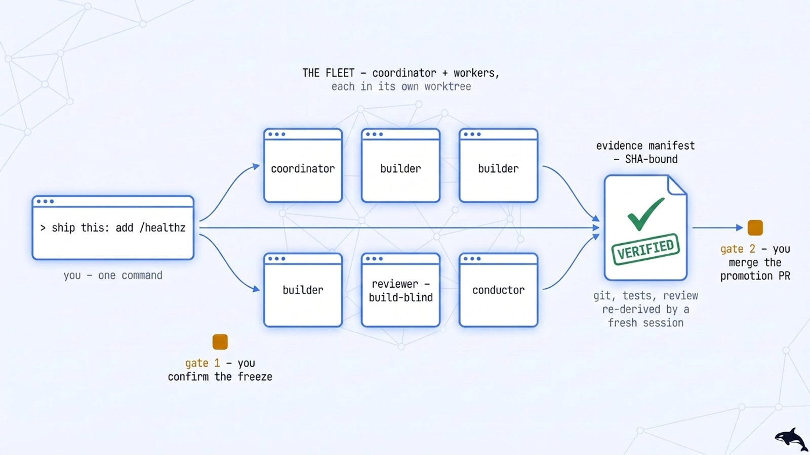
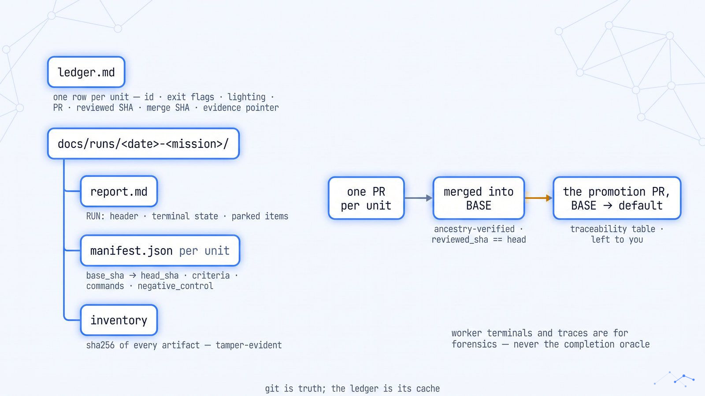
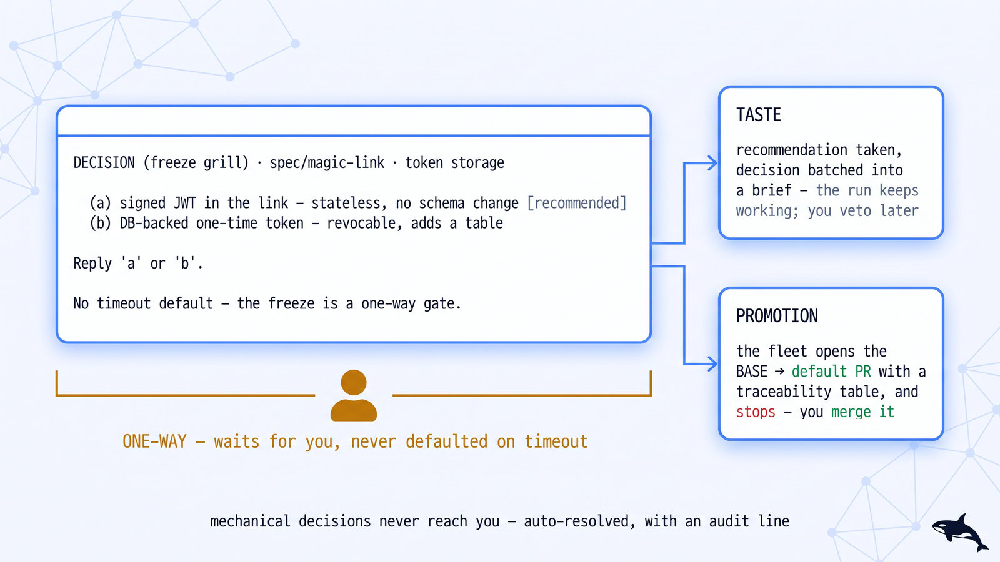

# Getting Started with open-fleet

[Documentation Hub](README.md) · [Install](install.md) · [Mission Guides](missions/README.md) · [Prompt Recipes](recipes.md)

Use this guide to run your first mission on a target repository. You will verify your runtime prerequisites, link the catalog, run a read-only [`review-it`](missions/review-it.md) dry run on an existing pull request, and then trace how [`ship-it`](missions/ship-it.md) takes a bounded feature from specification freeze to a promotion PR.

> [!NOTE]
> Looking to edit this repository or run its local contract tests? You only need `git` and Python ≥ 3.11 — jump to **[Local development](development.md)**.

## Contents

- [Prerequisites](#prerequisites)
- [Install the catalog](#install-the-catalog)
- [Your first mission: a review-it dry run](#your-first-mission-a-review-it-dry-run)
- [Your second mission: ship-it end to end](#your-second-mission-ship-it-end-to-end)
- [What you will see while a fleet runs](#what-you-will-see-while-a-fleet-runs)
- [Where the evidence lands](#where-the-evidence-lands)
- [Your side of the human gates](#your-side-of-the-human-gates)
- [What a run costs](#what-a-run-costs)
- [Troubleshooting](#troubleshooting)

---

## Prerequisites

<p align="center">
  <picture>
    <source media="(prefers-color-scheme: dark)" srcset="../assets/diagrams/install-stack.jpg">
    <source media="(prefers-color-scheme: light)" srcset="../assets/diagrams/install-stack-light.jpg">
    
  </picture>
</p>

Running a mission on a target project requires three core layers:

1. **An orchestration runtime (`OPEN_FLEET_RUNTIME`, default `auto` — [Multi-runtime & harness guide](runtimes.md)):**
   - **Standalone POSIX (`posix`):** Set `OPEN_FLEET_RUNTIME=posix` (or use `auto` when `orca` is not on `PATH`) to dispatch workers using local git worktrees, SQLite WAL state, and background processes (`tmux`, `cmux`, or `setsid`) without any external desktop app or daemon.
   - **Orca (`orca`):** The [Orca desktop app](https://github.com/stablyai/orca) (at or above the catalog pin **v1.4.239**), the `orca` CLI (`orca-ide` on Linux outside Orca terminals), and Orca's two public skills (`orchestration` and `orca-cli`). Verify Orca is running and ready:
     ```bash
     orca status --json
     ```
     If `"runtime": {"state": "not_running"}` is returned, run `orca open` and wait until `runtime.state` reads `ready` ([transcript](completion/evidence/P0-r3-orca-status.txt)).
   - **External orchestrators (12 providers):** Configure `overstory`, `t3code`, `ao`, `superset`, `gastown`, `worktrunk`, `jcode-swarm`, `emdash`, `vibe-kanban`, `paperclip`, `multiclaude`, or `openhands` in **[docs/runtimes.md](runtimes.md)**.
2. **`git` and `gh`**, authenticated (`gh auth status`). Fleets open pull requests per unit of work and verify merges by git ancestry. Repositories using Linear or Jira can use portable `runtime/scripts/pm.py` or `orca linear` / `orca jira` where supported.
3. **Python 3.11 or newer** (standard library only; no virtualenv required) for the runtime verification scripts (`runtime/scripts/verify.py`, `preflight.py`, `run_report.py`) and catalog checks.

### Per-mission tooling

Each mission declares any additional tooling in its `SKILL.md` frontmatter:

| If you plan to run | Also install |
|---|---|
| any mission | `git` + `gh` (plus `runtime/scripts/pm.py` or `orca linear` / `orca jira` for hosted trackers) |
| absorb-it | merge rights on the target and permission to comment on and close inbound PRs; a runnable suite; the repo's DCO/CLA policy |
| access-it | a deterministic a11y oracle (axe-core / Lighthouse) and a runnable surface |
| attest-it | the standard's own text (or a human-supplied obligation catalog) at a digest |
| clean-sweep | nothing beyond the base |
| deflake-it | a runnable suite; CI history is read via `gh run list` |
| document-it | an extractor for the public surface (or the run writes one) and a runnable claim check; a docs framework's local build, if the docs use one |
| field-test-it | the target its tier needs — an Orca emulator skill (`orca-emulator` / `orca-emulator-android`) or a paired device, a browser, `orca computer`, or a workspace recipe — plus the app's build toolchain |
| floor-it | the repo's own counters per dimension (coverage runner, scanner, harness, linter) and CI write access on BASE |
| harden-it | `gitleaks`; a host-unsafe exploit PoC parks on Orca (the danger lane is blocked there) and needs a placement-bound sandbox off it |
| map-it | nothing beyond the base |
| migrate-it | the project's migration runner, a database it can migrate and dump, a deploy path per phase (each deploy is your grant), read/write telemetry for the zero-use windows |
| modernize-it | the project's package manager; CI must be green at baseline |
| offload-it | a provider account + CLI with a sandbox/VM plan, Orca's `vm recipe doctor`, and an agent CLI + account for the auth snapshot |
| oncall-it | the target's logging/metrics/tracing libraries with a queryable backend, a staging environment whose failures can be induced, an observable alert destination |
| oss-contribute | a fork you can push to and read access to the upstream repo |
| pin-it | the installed Orca CLI itself (`orca skills get` is the re-witness oracle) |
| prove-it | a runnable suite plus a coverage tool it already supports |
| reshape-it | the repo's mutation tooling (or the hand-mutant fallback) plus a runnable suite |
| review-it | nothing beyond the base |
| root-cause | nothing beyond the base |
| ship-it | your deploy tooling and a canary surface, if you want the states past `RELEASED` |
| speed-it | a real measurement path: Lighthouse/DevTools access, or a load/profiler harness |

---

## Install the catalog

See **[Install](install.md)** for all installation options (whole-catalog `sh scripts/install.sh`, selective symlinks, or the Claude Code plugin). Keep the `open-fleet` clone on disk — symlinks and completion hooks resolve files inside it.

### Option A: Symlink install (recommended)

Missions resolve their playbooks (`playbooks/`) and runtime policies (`runtime/`) two levels above their skill folder. Always **symlink** rather than copy:

```bash
git clone https://github.com/ravidsrk/open-fleet.git
cd open-fleet
mkdir -p ~/.claude/skills
ln -s "$(pwd)/skills/ship-it"   ~/.claude/skills/ship-it
ln -s "$(pwd)/skills/review-it" ~/.claude/skills/review-it
```

Next, wire the native completion gate. Because `hooks/hooks.json` uses `${CLAUDE_PLUGIN_ROOT}` (which only exists in plugin installs), a symlink install requires merging the `"hooks"` block from the snippet into `~/.claude/settings.json` (delete the `_comment` keys if your settings reader rejects unknown keys):

```bash
sh hooks/print-settings-snippet.sh
```

Verify your hook registration, confirm `verify-gate.sh` is executable, and confirm the gate blocks a missing manifest (fail-closed):

```bash
test -x runtime/scripts/verify-gate.sh && grep -c verify-gate.sh ~/.claude/settings.json  # Expect: 2
ORCA_MANIFEST=/nonexistent.json sh runtime/scripts/verify-gate.sh --event stop; echo "exit $?"
```

The second command must output `BLOCKING (fail-closed)` and `exit 2` ([Verify gate details](verify-gate.md)).

### Option B: Claude Code plugin (whole catalog)

```text
/plugin marketplace add ravidsrk/open-fleet
/plugin install open-fleet@open-fleet
```

Confirm installation by asking your agent `"which missions are available?"` — you should see outcome-named skills such as `review-it` and `ship-it`.

---

## Your first mission: a review-it dry run

> [!IMPORTANT]
> Before running your first mission, review **[Before you run a mission](../README.md#before-you-run-a-mission)** for how worker permissions, git worktrees, and off-worker verification behave.

Start with [`review-it`](missions/review-it.md): it evaluates an existing pull request using read-only workers (`PROFILE=ro`) without modifying any code. Open a **fresh coding-agent session in the target repository** and prompt:

```text
review this PR: <PR URL>
Use <issue URL or spec path> as the acceptance criteria.
Return a SHA-bound GO/NO-GO verdict with findings grouped by review axis.
```

### What happens step by step

1. **Freeze the target:** The coordinator records the ledger header, pins the PR's head SHA (ensuring a non-empty diff), and freezes the acceptance criteria source.
2. **Parallel read-only dispatch:** Read-only workers (`PROFILE=ro`) evaluate the three core acceptance axes in parallel isolation:
   - *Repo standards & architecture*
   - *Spec fidelity*
   - *Test adequacy*
   - Conditional risk lenses (*security*, *performance*, *accessibility*, *data migration*) run only when triggered by the diff.
3. **Quote-backed filtering:** Any finding that cannot quote the exact file and line that motivated it is demoted to an informational appendix, eliminating speculative single-agent false positives.
4. **SHA-bound verdict:** You receive a `GO` or `NO-GO` verdict bound to `reviewed_sha`. Any Critical or Required finding forces `NO-GO`. If new commits are pushed later, the verdict is automatically staled ([`runtime/reviewed-sha-freshness.md`](../runtime/reviewed-sha-freshness.md)).

> **Proof tier:** `review-it` is proven at `external-run` ([2026-10-13 run report](runs/2026-10-13-review-it-linux.md) reviewing `stablyai/orca#28206` on Ubuntu). See [Proof status](concepts.md#proof-status) for what that tier guarantees.

---

## Your second mission: ship-it end to end

Once you have seen a read-only run, try [`ship-it`](missions/ship-it.md) on a small, self-contained feature in a repository with a passing baseline test suite:

```text
ship this: add GET /healthz through the existing router.
Return version and DB connectivity, with 503 when the database is unavailable.
Test both responses using the project's integration-test command.
Stop at the promotion PR.
```

### The pipeline in five phases

1. **Phase 0 — Preflight:** The coordinator verifies runtime readiness, checks that the integration `BASE` branch is not your default branch (`runtime/scripts/preflight.py`), and runs the baseline test suite. A red baseline stops the run immediately.
2. **Phase 1 — Grill & Freeze (Human Gate #1):** If you supplied high-level intent rather than a frozen spec, the coordinator asks clarifying questions one at a time (each with a recommended option), drafts the specification (objectives, acceptance criteria, non-goals, test seams), and waits for your **FREEZE** approval.
3. **Phase 2 — Decompose & Build:** The spec is decomposed into vertical tracer-bullet slices. Each slice is dispatched to an isolated builder worker in its own git worktree (`≤ 3` concurrent builders per [`runtime/attention-budget.md`](../runtime/attention-budget.md)). Workers write failing tests first and implement only their assigned slice.
4. **Phase 3 — Build-Blind Review & Negative Control:** Fresh reviewer sessions inspect each slice without seeing the builder's narration. The verifier checks git ancestry, review freshness, and the negative control (reverting the fix must make the new test go `RED`).
5. **Phase 4 — Merge Train & Promotion PR (Human Gate #2):** A single conductor merges verified slices into the integration `BASE` branch in arrival order, then opens the `BASE` → default branch **promotion PR** containing a full traceability table and stops for your merge decision.

---

## What you will see while a fleet runs

<p align="center">
  <picture>
    <source media="(prefers-color-scheme: dark)" srcset="../assets/diagrams/first-run.jpg">
    <source media="(prefers-color-scheme: light)" srcset="../assets/diagrams/first-run-light.jpg">
    
  </picture>
</p>

During an active run (walked hour-by-hour in **[Anatomy of a run](guides/anatomy-of-a-run.md)**), you will see four surfaces:

- **Coordinator terminal:** The session where you typed your prompt. It manages phase transitions, runs `verify.py`, updates the ledger, and surfaces human gates.
- **Worker terminals:** Ephemeral sessions (one per active unit in its own git worktree) that execute a single task, emit an evidence manifest, and exit. You never need to type into a worker terminal.
- **The run ledger:** A durable file tracking every unit's state flags (`BUILD_DONE`, `REVIEWED`, `MERGED`, `VERIFIED`), PR number, `reviewed_sha`, `merge_sha`, and manifest path.
- **Per-unit pull requests:** Opened against the integration `BASE` branch and merged by the conductor once verified.

Example ledger header written at `T0`:

```text
RUN: clean-sweep-chimely-20260715 · COORDINATOR: term_905ccdf2… + term_c5e4d798… ·
BASE: clean-sweep/integration · FORK_POINT: ce7891bf… · T0: 2026-07-15T17:40:00Z ·
SOURCE: tracker dodopayments/chimely open issues #34,35,36,37,38,39,55,56,58,61
(count=10, enumerated via gh api --paginate state=open)
```

---

## Where the evidence lands

<p align="center">
  <picture>
    <source media="(prefers-color-scheme: dark)" srcset="../assets/diagrams/artifacts-map.jpg">
    <source media="(prefers-color-scheme: light)" srcset="../assets/diagrams/artifacts-map-light.jpg">
    
  </picture>
</p>

Every completed unit emits a SHA-bound JSON **evidence manifest** ([schema reference](concepts.md#the-evidence-manifest) · [`runtime/evidence-manifest.md`](../runtime/evidence-manifest.md)):

- `base_sha` → `head_sha` — the exact git commit range for the unit.
- `criteria[]` — every acceptance criterion from the frozen contract, re-derived by `verify.py` so a worker cannot omit requirements.
- `intent` — on code-mutating units: `goal`, `ruled_out`, and `why`.
- `lighting` — `lit` (human/build-blind review required, the default) or `dark-eligible` (narrow Lane A changes with a deterministic oracle).
- `negative_control` — what was reverted or mutated and proof that the test suite went `RED`.
- `commands[]` — exact commands executed, exit codes, and artifact paths.
- `claim` — the worker's summary (informational only; never trusted as proof).

---

## Your side of the human gates

<p align="center">
  <picture>
    <source media="(prefers-color-scheme: dark)" srcset="../assets/diagrams/gates-terminal.jpg">
    <source media="(prefers-color-scheme: light)" srcset="../assets/diagrams/gates-terminal-light.jpg">
    
  </picture>
</p>

Decisions are classified below the model as **mechanical** (auto-resolved and logged), **taste** (recommended option selected immediately, batched for your later veto), or **one-way** (blocks until a human answers — never defaulted on timeout).

| Gate | Missions | What you do |
|---|---|---|
| **Freeze the target / contract** | `ship-it`, `map-it`, `access-it`, `attest-it`, `document-it`, `floor-it`, `migrate-it`, `oncall-it`, `prove-it`, `reshape-it`, `speed-it` | Inspect the testable acceptance criteria or scope denominator and approve the freeze. |
| **Promote `BASE` → default branch** | Every code-landing mission; every `migrate-it` phase | Review the promotion PR's traceability table and merge it yourself. |
| **Deploy / rollback / destructive drop** | `ship-it` past `RELEASED`; `migrate-it` phases and `CONTRACT` | Execute the deploy or record an explicit human grant (`decisions.py append --source human:<you>`). |
| **Refuted or duplicate issue closes** | `clean-sweep`, `absorb-it`, `oss-contribute` | Review the batched refutation evidence and approve or pull items out. |
| **External side-effects & grants** | `review-it` (posting verdict), `harden-it` (secret rotation), `offload-it` (paid cloud steps), `field-test-it` (device pairing) | Perform or authorize the external action explicitly. |

Example freeze prompt in your coordinator terminal:

```text
DECISION (freeze grill) · spec/magic-link · token storage
  (a) signed JWT in the link — stateless, no schema change; revocation only by expiry  [recommended]
  (b) DB-backed one-time token — revocable, adds a table + a cleanup job
Reply 'a' or 'b'. No timeout default — the freeze is a one-way gate, and its questions wait.
```

---

## What a run costs

- **Sessions scale with unit count:** Each unit of work (slice, finding, flake, or hypothesis) spawns an isolated builder session, a build-blind reviewer session, and a conductor merge turn. Concurrent builders are capped by the [attention budget](../runtime/attention-budget.md) (default ≤ 3).
- **Wall-clock expectations:** A `review-it` dry run takes minutes across a few read-only workers. A multi-slice `ship-it` or 10-issue `clean-sweep` is a multi-hour or overnight run ([retained run archive](runs/README.md)).
- **Start in a fresh session:** Activating a mission loads its coordinator instructions (~15% of a 200k-token context window), so always start a mission in a clean agent session rather than mid-conversation.

---

## Troubleshooting

See **[Troubleshooting](troubleshooting.md)** for the full diagnostic reference. Common first-run issues:

- **`"BASE is the default branch"` — preflight refuses to start:** By design, fleets never commit directly to `main`/`master`. Allow the coordinator to create an integration branch (e.g., `ship-it/integration`).
- **Playbooks or `../../ARCHITECTURE.md` not found:** The mission folder was copied instead of symlinked. Re-install using `sh scripts/install.sh` or `ln -s` per [Install the catalog](#install-the-catalog).
- **Baseline test suite is red:** Missions refuse to build on top of pre-existing test failures. Run [`deflake-it`](missions/deflake-it.md) for intermittent flakes or [`clean-sweep`](missions/clean-sweep.md) to fix deterministic failures first.
- **Worker stalled or coordinator interrupted:** Liveness supervision respawns stalled workers in clean terminals, and a restarted coordinator resumes from the ledger after re-verifying git ancestry ([`runtime/liveness-resume.md`](../runtime/liveness-resume.md)).
