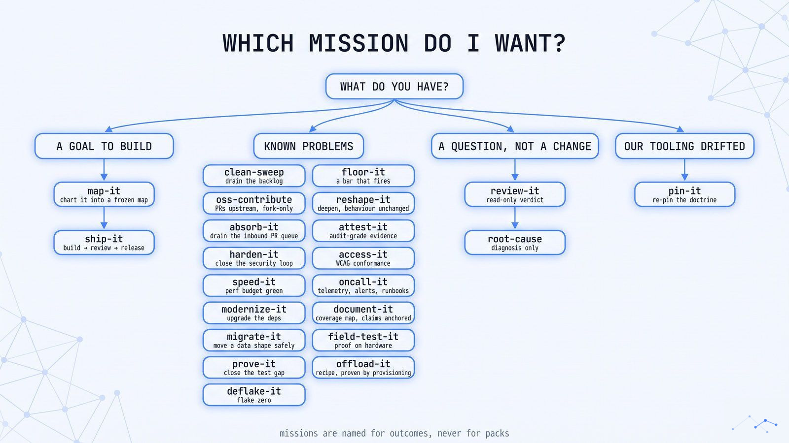
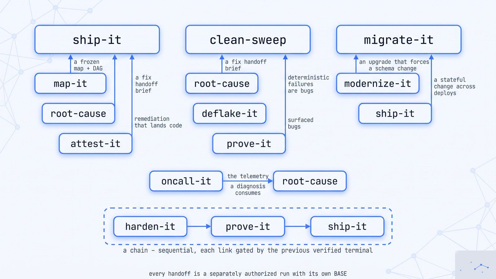

# Mission Guides

[Documentation Hub](../README.md) · [Getting Started](../getting-started.md) · [Adoption Guide](../adoption-guide.md) · [Prompt Recipes](../recipes.md) · [Concepts](../concepts.md)

Every mission in `open-fleet` is built for one distinct engineering outcome with its own unit of work, state machine, convergence proof, and SHA-bound evidence contract. The agent-facing skill definitions live in [`skills/`](../../skills/); these guides are written for developers and operators deciding which mission to run, what inputs to provide, what human approvals to expect, and how completion is proven.

---

## Choose by task

Pick the mission that matches your immediate engineering goal. Each guide displays a **Proof** callout showing its current retained evidence tier (`external-run`, `self-run`, or `doctrine-only`).

### 1. Plan, Build & Ship

| If you need to… | Run | When to use a neighboring mission instead |
|---|---|---|
| Resolve an ambiguous epic into a frozen architecture & task DAG | **[map-it](map-it.md)** | Scope and acceptance criteria are already clear → **[ship-it](ship-it.md)** |
| Build, review, and ship a feature or spec to a verified release state | **[ship-it](ship-it.md)** | Requires a multi-deploy database/schema migration → **[migrate-it](migrate-it.md)** |
| Open etiquette-correct PRs on an upstream repo you don't control | **[oss-contribute](oss-contribute.md)** | You own the repo and can merge to an integration branch → **[clean-sweep](clean-sweep.md)** |
| Triage, test, and land an inbound queue of contributor PRs | **[absorb-it](absorb-it.md)** | You only want a read-only verdict on a single PR → **[review-it](review-it.md)** |

### 2. Fix, Sweep & Stabilize

| If you need to… | Run | When to use a neighboring mission instead |
|---|---|---|
| Drain a finite backlog of issues, audit findings, or false doc claims | **[clean-sweep](clean-sweep.md)** | Fixing a single feature from scratch → **[ship-it](ship-it.md)** |
| Eradicate flaky tests to a statistical consecutive-green streak | **[deflake-it](deflake-it.md)** | Diagnosing one hard failure without suite-wide flake replay → **[root-cause](root-cause.md)** |
| Reproduce, fix, and prove a bug on a real mobile device or emulator | **[field-test-it](field-test-it.md)** | Diagnosing the cause without landing a fix → **[root-cause](root-cause.md)** |

### 3. Review, Diagnose & Prove

| If you need to… | Run | When to use a neighboring mission instead |
|---|---|---|
| Get a trusted, read-only, SHA-bound `GO` / `NO-GO` verdict on a PR | **[review-it](review-it.md)** | You want the fleet to fix the findings it discovers → **[clean-sweep](clean-sweep.md)** |
| Reproduce an unexplained bug and falsify rival hypotheses until one survives | **[root-cause](root-cause.md)** | The cause is already known and you just need the fix → **[ship-it](ship-it.md)** or **[clean-sweep](clean-sweep.md)** |
| Close test gaps on critical paths with mutation-audited tests | **[prove-it](prove-it.md)** | Enforcing repo-wide lint/type/coverage gates in CI → **[floor-it](floor-it.md)** |
| Establish a written quality bar where every CI gate is proven to fire | **[floor-it](floor-it.md)** | Writing unit/integration tests for specific code paths → **[prove-it](prove-it.md)** |

### 4. Audit, Harden & Attest

| If you need to… | Run | When to use a neighboring mission instead |
|---|---|---|
| Run a full security loop: audit → exploit → fix → re-attack → clean re-audit | **[harden-it](harden-it.md)** | Read-only security review on a single PR → **[review-it](review-it.md)** |
| Assemble auditor-grade conformance evidence (SOC 2, EU AI Act, NIST SSDF) | **[attest-it](attest-it.md)** | Exploiting and fixing vulnerabilities rather than attesting controls → **[harden-it](harden-it.md)** |
| Drive a page/flow set to WCAG 2.2 AA conformance with axe-core + revert controls | **[access-it](access-it.md)** | General UI feature work → **[ship-it](ship-it.md)** |
| Bring user journeys within a declared performance budget | **[speed-it](speed-it.md)** | Refactoring code structure without a latency/throughput budget → **[reshape-it](reshape-it.md)** |

### 5. Evolve, Refactor & Migrate

| If you need to… | Run | When to use a neighboring mission instead |
|---|---|---|
| Upgrade dependencies or migrate frameworks safely across the codebase | **[modernize-it](modernize-it.md)** | Moving persistent database schemas or data across deploys → **[migrate-it](migrate-it.md)** |
| Deepen god files behind narrow interfaces with behavior proven unchanged | **[reshape-it](reshape-it.md)** | Fixing functional bugs in those modules → **[clean-sweep](clean-sweep.md)** |
| Execute a zero-downtime expand → backfill → switch → contract data migration | **[migrate-it](migrate-it.md)** | Stateless code or dependency upgrades → **[modernize-it](modernize-it.md)** |

### 6. Operate, Document & Provision

| If you need to… | Run | When to use a neighboring mission instead |
|---|---|---|
| Add telemetry, test-fired symptom alerts, and source-blind runbooks | **[oncall-it](oncall-it.md)** | Diagnosing an active incident right now → **[root-cause](root-cause.md)** |
| Achieve complete, symbol-anchored public documentation coverage | **[document-it](document-it.md)** | Fixing specific inaccuracies in existing docs → **[clean-sweep](clean-sweep.md)** |
| Stand up and validate a cloud/sandbox workspace recipe (`create→validate→destroy`) | **[offload-it](offload-it.md)** | Testing your application on a mobile device or clean host → **[field-test-it](field-test-it.md)** |
| Re-witness `open-fleet`'s own runtime policies against a new Orca binary | **[pin-it](pin-it.md)** | Upgrading dependencies in your own application → **[modernize-it](modernize-it.md)** |

> [!TIP]
> **Chaining missions:** Start with a single bounded outcome. When a goal spans multiple outcomes (for example, `map-it` → `ship-it`, or `harden-it` → `prove-it` → `ship-it`), declare a [sequential chain](../concepts.md#chaining-missions) and its allowed terminal states up front.

---

## All mission guides

  <picture>
    <source media="(prefers-color-scheme: dark)" srcset="../assets/diagrams/mission-map.jpg">
    <source media="(prefers-color-scheme: light)" srcset="../assets/diagrams/mission-map-light.jpg">
    
  </picture>

How the missions hand work to one another:

  <picture>
    <source media="(prefers-color-scheme: dark)" srcset="../assets/diagrams/mission-handoffs.jpg">
    <source media="(prefers-color-scheme: light)" srcset="../assets/diagrams/mission-handoffs-light.jpg">
    
  </picture>

| Guide | One line |
|-------|----------|
| 🚢 [ship-it](ship-it.md)                 | Intent or a frozen spec → a released, verified change |
| 🧹 [clean-sweep](clean-sweep.md)         | A finite backlog exhausted to zero, PR-per-finding, re-enumerated until dry |
| 🤝 [oss-contribute](oss-contribute.md)   | Upstream issues → open, reviewed, etiquette-correct PRs on a repo you cannot merge |
| 🛡️ [harden-it](harden-it.md)       | A threat model closed: audit → exploit → fix → re-attack → clean re-audit |
| ⚡ [speed-it](speed-it.md)          | Every declared journey within its perf budget, proven to a measurement contract |
| 📦 [modernize-it](modernize-it.md) | Every dependency current or pinned-with-a-reason, CI green the whole way |
| 🧪 [prove-it](prove-it.md)         | A mutation-audited test on every critical path |
| 🎯 [deflake-it](deflake-it.md)     | Flakes eradicated to a consecutive-green streak, local and CI |
| 🔍 [review-it](review-it.md)       | A read-only, SHA-bound GO/NO-GO verdict — no fix authority |
| 🗺️ [map-it](map-it.md)             | A foggy goal resolved into a frozen execution map ship-it can consume |
| 🔬 [root-cause](root-cause.md)     | A reproduced symptom and a demonstrated cause — diagnosis only |
| 📋 [attest-it](attest-it.md)       | Conformance to a frozen standard, independently re-derived: `CONFORMANT` or gaps parked |
| ♿ [access-it](access-it.md)       | A frozen page/flow set driven to WCAG 2.2 AA with a revert-to-violation control |
| 📌 [pin-it](pin-it.md)             | Runtime doctrine re-witnessed against the installed binary — every claim receipted |
| 🧱 [floor-it](floor-it.md)         | A written, numbered quality bar — every dimension tool-enforced and proven to fire |
| 🧬 [reshape-it](reshape-it.md)     | Hot modules deepened behind smaller interfaces, behaviour proven unchanged |
| 📱 [field-test-it](field-test-it.md) | Defects reproduced, fixed, and re-proven on a real device — revert control included |
| 🗄️ [migrate-it](migrate-it.md)     | A stateful shape change landed phase by phase across deploys — parity proven, zero readers and writers before the drop |
| 📟 [oncall-it](oncall-it.md)       | A frozen path set made operable — alerts test-fired, and an induced failure named by a source-blind worker |
| 📥 [absorb-it](absorb-it.md)       | An inbound PR queue drained — landed with authorship and a receipt, refuted, or parked with a named ask |
| 📚 [document-it](document-it.md)   | A public surface covered by quadrant with zero critical gaps — every claim anchored and rename-controlled |
| ☁️ [offload-it](offload-it.md)     | A per-workspace environment recipe stood up and proven by a live provision — doctor-clear plus an enacted lifecycle |

---

## How to tell a mission is working ("It's working if…")

When you run a mission for the first time, use these observable behavioral tells to verify that the coordinator has loaded the mission protocol (`skills/<name>/SKILL.md`) rather than improvising as a single chat agent:

### It's working if…

1. **Phase 0 runs `preflight.py` before dispatching workers:** On code-mutating missions, the coordinator runs `preflight.py --base <BASE>` (verifying `BASE` is not your default branch) and separately runs the baseline test command to confirm `T0` is green. On report-only/non-promoting missions (`review-it`, `map-it`, `root-cause`, `attest-it`, `oss-contribute`), the coordinator runs `preflight.py --mode readonly`.
2. **The `T0` ledger header is written before worker dispatch:** You see a ledger header recording `RUN`, `COORDINATOR`, `BASE` (`-` on report-only and planning missions), `FORK_POINT`, `T0`, the frozen `SOURCE` denominator, and the `WIP` cap.
3. **One-way gates ask with a recommended option on every question and wait:** During spec/contract freeze or promotion, the coordinator stops and waits for your explicit reply without auto-continuing on timeout.
4. **The coordinator dispatches isolated workers rather than editing application files itself:** Workers run in separate sessions or git worktrees (`≤ 3` concurrent builders per [`runtime/attention-budget.md`](../../runtime/attention-budget.md)), each mounting at most **one** upstream pack router.
5. **Reviewers are build-blind and SHA-bound:** On code-mutating missions, a fresh reviewer session (`PROFILE=ro`, or `rw` where it must run mutation tests) inspects the PR diff without seeing the builder's narrative summary and records `reviewed_sha == head_sha`.
6. **Evidence is bound to a SHA in a manifest (`verify.py` on code-mutating missions):** Code-mutating units are graded by `runtime/scripts/verify.py` (checking frozen scope digest, git ancestry on `BASE`, review freshness, and the executed negative control); report-only missions (`review-it`, `attest-it`) emit a report-only manifest bound to `head_sha` / `reviewed_sha`, and planning missions (`map-it`, `root-cause`) a planning manifest checked by artifact verification, neither executing code-mutating negative controls (`review-it` forbids executed controls and judges test coverage statically from the diff).

### Red flags (the agent is freelancing without the mission protocol)

- On a code-mutating mission, the agent starts editing application files directly in your main checkout on `main` without running `preflight.py` or creating an integration `BASE` branch.
- Multiple upstream packs (`mattpocock`, `gstack`, `addyosmani`) are pasted into the same worker prompt.
- A unit is marked complete without a SHA-bound evidence manifest JSON file (or, on a code-mutating mission, without a negative-control check).
- *Fix:* Verify your symlink or plugin installation via **[Install — Check the install](../install.md#check-the-install)** and invoke the mission by name at the start of a **fresh** agent session.

For a concrete trace of a multi-worker run with real verification failures and recovery, read **[Anatomy of a run](../guides/anatomy-of-a-run.md)**.
