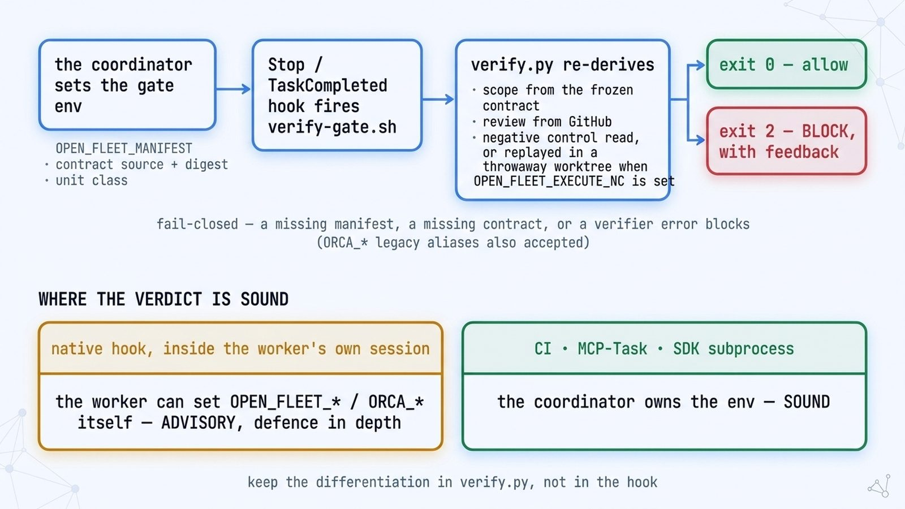

# The Verify Gate — Native Hooks and Off-Worker Verification

[Documentation Hub](README.md) · [Install](install.md) · [Concepts](concepts.md#independent-verification) · [Troubleshooting](troubleshooting.md#the-gate-blocks-a-turn-or-task)

`open-fleet` packages its independent verifier ([`runtime/scripts/verify.py`](../runtime/scripts/verify.py)) as a fail-closed **completion gate** ([`runtime/scripts/verify-gate.sh`](../runtime/scripts/verify-gate.sh)): a unit of work cannot be marked complete until its SHA-bound evidence manifest passes verification against authorities outside the worker's own narration.

On this page:
- [Install paths, and which ones carry the gate](#install-paths-and-which-ones-carry-the-gate)
- [Native path — plugin hooks](#native-path--plugin-hooks-set-claude_plugin_root)
- [Fallback path — CI, MCP Task, and SDK subprocess](#fallback-path--where-allowmanagedhooksonly-disables-plugin-hooks)
- [Trust boundary](#trust-boundary)
- [Signed dispatch and verifier transcripts](#signed-dispatch--what-it-binds-and-where-the-key-comes-from-135)

<p align="center">
  <picture>
    <source media="(prefers-color-scheme: dark)" srcset="../assets/diagrams/verify-gate.jpg">
    <source media="(prefers-color-scheme: light)" srcset="../assets/diagrams/verify-gate-light.jpg">
    
  </picture>
</p>

## Install paths, and which ones carry the gate

| Install path | `${CLAUDE_PLUGIN_ROOT}` | Completion gate behavior |
|---|---|---|
| **Claude Code plugin** (`/plugin install open-fleet@open-fleet`) | Set by Claude Code | Automatically wired by [`hooks/hooks.json`](../hooks/hooks.json); confirm activation in the plugin manager |
| **Symlink install** (`sh scripts/install.sh` or `ln -s`) | **Unset** | **Off until wired:** run `sh hooks/print-settings-snippet.sh` and merge the output into `~/.claude/settings.json` |
| **Copy installer** (repo root copy) | Unset | **Unsupported from source root** — copying a single skill folder severs relative `playbooks/` and `runtime/` paths; use a published `dist/` bundle ([Install](install.md#copy-installers-and-bundles)) |

[`hooks/settings-snippet.json`](../hooks/settings-snippet.json) provides the `Stop` and `TaskCompleted` hook definitions, and [`hooks/print-settings-snippet.sh`](../hooks/print-settings-snippet.sh) resolves the absolute path to your local `open-fleet` clone (`--check` verifies the template and gate script exist on disk).

---

## Native path — plugin hooks (set `${CLAUDE_PLUGIN_ROOT}`)

[`hooks/hooks.json`](../hooks/hooks.json) binds two lifecycle events to [`runtime/scripts/verify-gate.sh`](../runtime/scripts/verify-gate.sh):

- **`TaskCompleted` (`--event task`):** Per-unit completion hook. Requires `ORCA_MANIFEST` to be set and valid; exits `2` to block completion and return feedback if the manifest is missing or fails any check.
- **`Stop` (`--event stop`):** Turn-end hook. If no unit is in progress (`ORCA_MANIFEST` is unset), it exits `0` to allow normal conversation turns. If `ORCA_MANIFEST` is set, it runs full verification and exits `2` (fail-closed) if any check fails.

```text
Coordinator sets gate environment variables
   → TaskCompleted / Stop hook invokes verify-gate.sh
       → verify.py re-derives claims against external authorities:
          • Scope         ← Coordinator-frozen contract source & digest
          • Ancestry      ← git merge-base --is-ancestor on BASE
          • Review        ← GitHub API APPROVED review at head_sha
          • Neg. control  ← Executed replay in a throwaway worktree (when OPEN_FLEET_EXECUTE_NC / ORCA_EXECUTE_NC is set)
          • Commands      ← Worktree-bound exit-0 command records
           → exit 0 (ALLOW) · exit 2 (BLOCK, fail-closed)
```

### Environment variables (`OPEN_FLEET_*` and `ORCA_*`)

Every input below is read by `verify-gate.sh` under both its neutral `OPEN_FLEET_*` name and its legacy `ORCA_*` alias ([Multi-runtime guide](runtimes.md); `OPEN_FLEET_MANIFEST` also accepts `OPEN_FLEET_GATE_MANIFEST` or `ORCA_MANIFEST`). If both spellings are set to conflicting values, `verify-gate.sh` fails closed (exit `2`):

- `ORCA_MANIFEST` (`OPEN_FLEET_MANIFEST` / `OPEN_FLEET_GATE_MANIFEST`) — Path to the unit's JSON evidence manifest. Required for `TaskCompleted`; on `Stop`, unset means no unit is in flight (exit `0`), while a named-but-missing file blocks (exit `2`).
- `ORCA_CONTRACT_SOURCE` / `ORCA_CONTRACT_DIGEST` (`OPEN_FLEET_CONTRACT_SOURCE` / `OPEN_FLEET_CONTRACT_DIGEST`) — The frozen contract `path@ref` and its SHA-256 digest. Without both, scope verification fails closed.
- `ORCA_UNIT_CLASS` (`OPEN_FLEET_UNIT_CLASS`) — `mutation | report-only | planning` (defaults to `mutation` when unset or unrecognized). On an unsigned native run, a `report-only` or `planning` claim is cross-checked against `base_sha..head_sha`: if any non-prose file changed (tests count as code), if the range cannot be resolved, or if `base_sha == head_sha`, the check fails (`RED`). A valid prose-only (docs) commit range passes with an `(unsupervised)` label unless authorized by a signed dispatch record.
- `ORCA_REPO` (`OPEN_FLEET_REPO`) — `owner/name` for the GitHub review lookup. Approvals count only from non-author accounts with `OWNER`, `MEMBER`, or `COLLABORATOR` standing, while `CHANGES_REQUESTED` from any non-author blocks. Required on sound off-worker lanes (`ORCA_PROVENANCE` / `OPEN_FLEET_PROVENANCE` set or enforcement mode); `gh` is resolved once at startup, and every directory and symlink hop from `/` to the binary must be beyond the worker's reach: not under the work tree or the temp dir, and not owned or writable by the running user (a probe, never a list of bin-directory names).
- `ORCA_BASE` / `ORCA_SYMBOL` (`OPEN_FLEET_BASE` / `OPEN_FLEET_SYMBOL`) — Integration base branch for git ancestry verification and an optional symbol to grep on `origin/<base>`. Missing `origin/<base>` is a `NOTE` on the advisory native path and fatal on sound off-worker lanes.
- `ORCA_NC_COMMAND` (`OPEN_FLEET_NC_COMMAND`) — The authoritative criterion-bound test command that the negative control must turn `RED` (forwarded as `--nc-command`). Must match `negative_control.command` in the manifest, and is **required whenever `ORCA_EXECUTE_NC` (`OPEN_FLEET_EXECUTE_NC`) is set** so a worker cannot nominate a trivial self-chosen command.
- `ORCA_EXECUTE_NC` (`OPEN_FLEET_EXECUTE_NC`) — When set to any non-empty value, forwards `--execute-nc`, which **executes the negative control** in a throwaway worktree rather than merely reading the manifest's description:
  - **Replay phases:** Checks out `head_sha`, applies the control (`tool: revert` restores `negative_control.paths` from `base_sha`, or `tool: hand` applies the quoted unified diff), seals the tree into a sibling commit, and executes `3 runs of the bound command` across `4 checkouts` (1 scratch worktree to apply and seal the control + 1 isolated checkout per phase) with a 600 s timeout each:
    1. Clean `head_sha` → must exit **0** (`GREEN`)
    2. Sealed control tree → must exit **non-zero** (`RED`) with a real test assertion failure
    3. Clean `head_sha` → must exit **0** (`GREEN`)
  - **Hygienic environment & git isolation:** Runs under a minimal 6-variable environment floor (`PATH`, `HOME`, `TMPDIR`/`TMP`/`TEMP`, `LANG`/`LC_*`) with fresh empty `HOME` and `TMPDIR` per phase, tag signatures stripped, `core.hooksPath=/dev/null`, and any repository-configured git filters (`fsmonitor`, `clean`/`smudge`, `textconv`, `merge` drivers) neutralized before checkout.
  - **Production-code binding:** The reverted or patched paths must be production files modified in `base_sha..head_sha` (never test files discovered by `pytest`, `unittest`, `jest`, or `vitest`), and syntax/import load errors are rejected as stillborn mutants.
- `ORCA_NO_GH` (`OPEN_FLEET_NO_GH`) — Enables the offline **no-gh lane**, switching review verification from GitHub API lookup to a local reviewer artifact (a trust downgrade; see [Trust boundary](#trust-boundary)). **Requires `ORCA_EXECUTE_NC` (`OPEN_FLEET_EXECUTE_NC`)** and an out-of-band coordinator contract.
- `ORCA_UNIT_LANE` (`OPEN_FLEET_UNIT_LANE`) — `A | B | 0` lane classification from dispatch (forwarded as `--lane`). Rejects Lane-0 mutations and `dark-eligible` claims outside Lane A.
- `ORCA_LIGHTING` (`OPEN_FLEET_LIGHTING`) — Coordinator lighting classification (`lit` or `dark-eligible`). Setting `dark-eligible` waives human/build-blind review and therefore **requires `ORCA_EXECUTE_NC` (`OPEN_FLEET_EXECUTE_NC`)**.
- `ORCA_PROVENANCE` (`OPEN_FLEET_PROVENANCE`) — `ci|mcp|sdk|dispatch` asserting that the environment was populated off-worker; enables strict authority enforcement and suppresses the in-session advisory `NOTE`.
- `ORCA_DISPATCH_RECORD` (`OPEN_FLEET_DISPATCH_RECORD`) — Path (or `path@ref`) to the coordinator-signed dispatch envelope binding the contract digest, unit class, profile, and lighting.
- `ORCA_DISPATCH_PUBKEY` (`OPEN_FLEET_DISPATCH_PUBKEY`) — Ed25519 verifying public key overriding repository key discovery (trustworthy only when set off-worker).

---

## Fallback path — where `allowManagedHooksOnly` disables plugin hooks

In enterprise environments where `allowManagedHooksOnly` disables user or plugin hooks, run the exact same verifier off-hook:

1. **CI pipeline gate (recommended):**
   ```yaml
   - name: Verify unit evidence manifest
     run: |
       git fetch origin "${ORCA_BASE:?set ORCA_BASE to the integration branch}"
       python3 runtime/scripts/verify.py --manifest "$ORCA_MANIFEST" \
         --contract-source "$ORCA_CONTRACT_SOURCE" --contract-digest "$ORCA_CONTRACT_DIGEST" \
         --repo "$GITHUB_REPOSITORY" --base "$ORCA_BASE" \
         --execute-nc --nc-command "$ORCA_NC_COMMAND" --provenance ci
   ```
   *(Pass `--execute-nc --nc-command "$ORCA_NC_COMMAND"` so the CI runner replays the negative control in a throwaway worktree rather than merely reading the manifest's artifact text. Require an explicit integration-branch ref `ORCA_BASE` after `git fetch origin` rather than falling back to `main` or `$GITHUB_BASE_REF`, since unit commits land on the integration `BASE` branch before promotion.)*
2. **MCP Task:** Expose `verify.py` as an MCP Task awaited by the coordinator before advancing the ledger ([Platform capabilities](platform-ride.md)).
3. **SDK subprocess:** Invoke `runtime/scripts/verify-gate.sh` directly from the coordinator process at unit boundaries.

---

## Trust boundary

`verify.py` validates worker claims against external authorities, **but those checks are only as sound as the provenance of the environment variables that configure them**:

- **In-session native hooks (`Stop` / `TaskCompleted`) are ADVISORY:** Because native hooks execute inside the worker's own shell environment, a compromised or adversarial worker could alter `ORCA_*` variables or local git refs. Native hooks catch accidental omissions and malformed manifests as defense-in-depth, and emit an advisory `NOTE` unless `ORCA_PROVENANCE` confirms off-worker execution.
- **CI, MCP Task, and coordinator subprocesses are SOUND:** When an external process owns the environment and runs against a clean fetch of the repository with system-owned binaries (`git`, `gh`, `gitleaks`), the worker cannot tamper with the contract digest, unit class, or verifying key.
- **The `ORCA_NO_GH` lane is an explicit downgrade:** Setting `ORCA_NO_GH` replaces the independent GitHub API review check with a local review artifact corroborated by the coordinator contract. It is intended only for sanctioned offline environments and must never be enabled in shared CI templates where it would downgrade review verification.

---

### Signed dispatch — what it binds, and where the key comes from (#135)

> [!NOTE]
> **Implemented mechanism, dormant by default:** The Ed25519 signing mechanisms below are implemented in `runtime/scripts/dispatch-sign.py`, `verify.py`, and `run_report.py`. Today, no mission or playbook signs a dispatch by default, and the **signed verifier transcript** flow is exercised by no real run yet. **Committing `.orca/dispatch-pubkey` is the enforcement switch for both**: once committed on the default branch, `verify-gate.sh` requires a valid signed dispatch record. For `run_report.py`, a report pin already in the grading branch's history reads the key at that pin, so a pin from before the key landed retains the unsigned path. A pin outside that history reads the key at the current grading branch instead, so an older fork does not avoid the signed-transcript requirement.

When `.orca/dispatch-pubkey` is active, the coordinator signs a canonical dispatch record (`runtime/scripts/dispatch-sign.py`) binding:
- **Core fields:** `manifest_id`, `contract_digest`, `unit_class`, `lighting`, `profile`, `parent_profile`, and optional lane flags (`no_gh`, `lane`, `execute_nc`).
- **Optional negative-control pins:** `nc_paths` (as a set), `nc_command`, and `nc_artifact_sha256` (when known at dispatch time, such as targeted bug-fix reruns).

**Verifying key discovery order in `verify-gate.sh`:**
1. `ORCA_DISPATCH_PUBKEY` environment variable (trustworthy when set off-worker via `ORCA_PROVENANCE=ci|mcp|sdk|dispatch`).
2. `.orca/dispatch-pubkey` read from `refs/remotes/origin/HEAD` in the target repository.
3. `.orca/dispatch-pubkey` in the target repository's working tree.

**Operational setup when enabling signed dispatch and signed verifier transcripts:**
1. **Generate keypair (off-worker):** `python3 runtime/scripts/dispatch-sign.py gen-key --out <secret>` and commit `<secret>.pub` as `.orca/dispatch-pubkey` on the default branch.
2. **Sign per dispatch (coordinator):**
   ```bash
   python3 runtime/scripts/dispatch-sign.py sign --key <secret> \
     --manifest-id <unit-id> --contract-digest <sha256> --unit-class mutation --lighting lit \
     > /tmp/dispatch-record.json
   ```
3. **Verify at gate and emit a signed verifier transcript:** `verify.py` validates the Ed25519 dispatch signature (via vendored RFC 8032 `runtime/scripts/ed25519.py`) and fails closed on any field substitution, replay across units, or missing signature (`verify-gate.sh` forwards `ORCA_DISPATCH_RECORD` and the discovered `.orca/dispatch-pubkey`; when invoking `verify.py` directly, pass `--dispatch-record` and `--dispatch-pubkey` explicitly). Once `.orca/dispatch-pubkey` is committed, `run_report.py` also requires a signed verifier transcript (`transcript=<path>` in the report's `RUN:` header) binding the manifest digest, exit code, and argument tuple:
   - **Without `--execute-nc`:** Pass `--dispatch-record /tmp/dispatch-record.json --dispatch-pubkey .orca/dispatch-pubkey --transcript-out <signed.json> --transcript-key <secret>` directly to `verify.py`.
   - **With `--execute-nc` (recommended two-process flow):** Because `--execute-nc` executes repository tests under the current user ID, `verify.py` refuses `--transcript-key` alongside `--execute-nc` so the private seed is never loaded into the test-execution process. Instead, write an unsigned verdict first and sign it in a separate process (which re-hashes `toolchain.files` against its sibling scripts before signing):
     ```bash
     python3 runtime/scripts/verify.py --manifest "$ORCA_MANIFEST" \
       --contract-source "$ORCA_CONTRACT_SOURCE" --contract-digest "$ORCA_CONTRACT_DIGEST" \
       --repo "$GITHUB_REPOSITORY" --base "${ORCA_BASE:?set ORCA_BASE to the integration branch}" \
       --dispatch-record /tmp/dispatch-record.json --dispatch-pubkey .orca/dispatch-pubkey \
       --execute-nc --nc-command "$ORCA_NC_COMMAND" --provenance ci \
       --transcript-out /tmp/verdict-unsigned.json

     python3 runtime/scripts/dispatch-sign.py sign-transcript --key <secret> \
       --transcript /tmp/verdict-unsigned.json --out docs/runs/<run>/verifier-transcript.json
     ```
